<picture>
  <source media="(prefers-color-scheme: dark)" srcset="card_profile_dark.svg" />
  <source media="(prefers-color-scheme: light)" srcset="card_profile_light.svg" />
  
</picture>

<picture>
  <source media="(prefers-color-scheme: dark)" srcset="card_journey_dark.svg" />
  <source media="(prefers-color-scheme: light)" srcset="card_journey_light.svg" />
  
</picture>

<a href="https://www.mariam-hussein.dev"><picture><source media="(prefers-color-scheme: dark)" srcset="link_web_dark.svg" /><source media="(prefers-color-scheme: light)" srcset="link_web_light.svg" /></picture></a>&nbsp;&nbsp;<a href="https://www.linkedin.com/in/mariamhusse1n/"><picture><source media="(prefers-color-scheme: dark)" srcset="link_linkedin_dark.svg" /><source media="(prefers-color-scheme: light)" srcset="link_linkedin_light.svg" /></picture></a> <a href="https://github.com/mazzilio"><picture><source media="(prefers-color-scheme: dark)" srcset="link_github_dark.svg" /><source media="(prefers-color-scheme: light)" srcset="link_github_light.svg" /></picture></a>&nbsp;&nbsp;<a href="https://www.tiktok.com/@mazzilio"><picture><source media="(prefers-color-scheme: dark)" srcset="link_tiktok_dark.svg" /><source media="(prefers-color-scheme: light)" srcset="link_tiktok_light.svg" /></picture></a>

